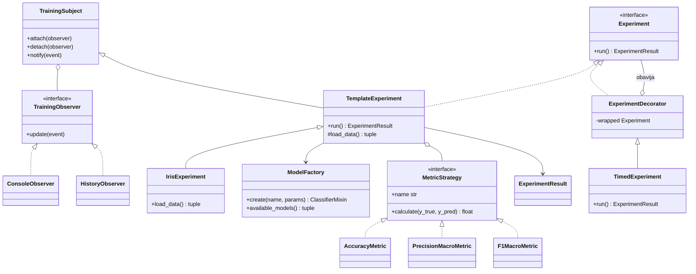

# Mini okvir za ML eksperimente

Python projekat koji demonstrira pet obrazaca dizajna kroz klasifikaciju Iris skupa podataka:

- **Factory** kreira linearni model, stablo odlučivanja ili kNN;
- **Strategy** omogućava zamjenu metrike evaluacije;
- **Observer** prati faze treniranja;
- **Template Method** definiše tok eksperimenta;
- **Decorator** mjeri ukupno vrijeme izvršavanja.

## Pokretanje

Potrebni su Python 3.10 ili noviji i `pip`.

```bash
python -m venv .venv
.venv\Scripts\activate
python -m pip install -r requirements.txt
python -m pytest -v
python -m ml_experiments.demo
```

Alternativno, projekat se može instalirati u razvojnom režimu:

```bash
python -m pip install -e ".[dev]"
python -m pytest -v
python -m ml_experiments
```

## Primjer izlaza

```text
Mini okvir za ML eksperimente — Iris dataset

[started] Eksperiment je pokrenut.
[data_loaded] Podaci su učitani.
[data_split] Podaci su podijeljeni na trening i test skup.
[training_started] Počinje treniranje modela 'linear'.
[training_finished] Treniranje je završeno.
[evaluated] accuracy = 0.9474
REZULTAT: linear        | accuracy=0.9474 | vrijeme=0.02s
```

Tačne vrijednosti i vrijeme mogu se malo razlikovati između računara.

## Arhitektura



## Kako su obrasci primijenjeni

### Factory

`ModelFactory.create()` mapira tekstualni naziv na konkretnu scikit-learn klasu. Ostatak aplikacije ne uvozi `LogisticRegression`, `DecisionTreeClassifier` ili `KNeighborsClassifier`. Nepoznat naziv izaziva `UnknownModelError` sa listom dozvoljenih modela.

### Strategy

`MetricStrategy` definiše zajedničku operaciju `calculate`. Implementirane su strategije za accuracy, macro precision i macro F1. Eksperiment prima strategiju kroz konstruktor, pa se metrika mijenja bez izmjene toka eksperimenta.

### Observer

`TemplateExperiment` emituje događaje tokom učitavanja podataka, podjele, treniranja i evaluacije. `ConsoleObserver` ih prikazuje, dok ih `HistoryObserver` čuva. Novi posmatrač, na primjer za bazu ili web interfejs, može se dodati bez izmjene eksperimenta.

### Template Method

`TemplateExperiment.run()` određuje stabilan redosljed: učitavanje podataka, podjela, kreiranje modela, treniranje, predikcija i evaluacija. `IrisExperiment` implementira promjenjivi korak `load_data()`.

### Decorator

`TimedExperiment` obavija bilo koji objekat interfejsa `Experiment`, mjeri trajanje poziva `run()` i dodaje ga u rezultat. Osnovni eksperiment ostaje odgovoran samo za ML tok.

## Struktura projekta

```text
mini-ml-okvir/
├── src/ml_experiments/
│   ├── factory.py
│   ├── metrics.py
│   ├── observers.py
│   ├── experiment.py
│   ├── decorators.py
│   └── demo.py
├── tests/
│   ├── test_factory.py
│   ├── test_metrics.py
│   └── test_experiment.py
├── pyproject.toml
├── requirements.txt
└── README.md
```

## Testovi

Projekat sadrži više od traženih pet `pytest` testova. Pokriveni su:

- kreiranje sva tri modela i prosljeđivanje parametara;
- jasna greška za nepoznat model;
- tri strategije metrike;
- kompletan Template Method tok na Iris skupu;
- redosljed Observer događaja i odjava posmatrača;
- dodavanje vremena preko dekoratora.

## Upotreba AI alata

OpenAI Codex je korišćen kao pomoć pri:

- razradi početne arhitekture i raspodjeli odgovornosti između obrazaca;
- generisanju početne verzije Python koda, Mermaid dijagrama i testova;
- pronalaženju rubnih slučajeva, poput nepoznatog naziva modela i odjave posmatrača;
- pokretanju testova i provjeri demonstracije.

AI izlaz nije tretiran kao automatski ispravan. Struktura, tipovi, poruke grešaka, testovi i ponašanje na Iris skupu pregledani su i provjereni izvršavanjem. Za produkcionu upotrebu bilo bi potrebno dodatno provjeriti bezbjednost, performanse, verzije zavisnosti i ponašanje na stvarnim skupovima podataka.
